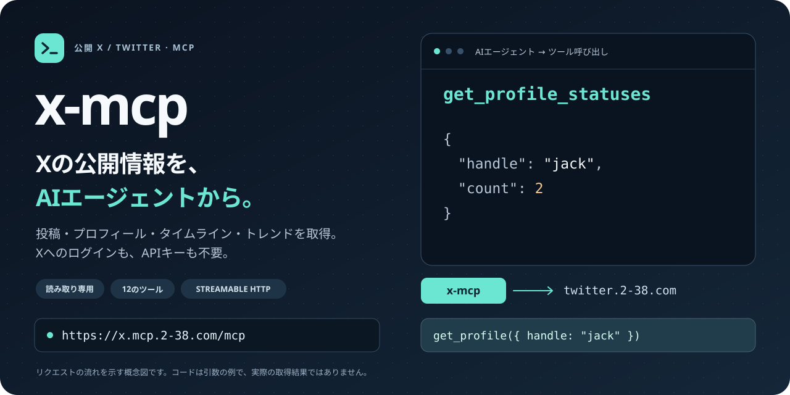
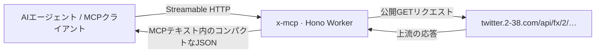

<div align="center">



# x-mcp

**X/Twitterの公開情報を、いつものAIエージェントから。**<br>投稿・プロフィール・タイムライン・フォロワー・トレンドを、読み取り専用のMCPで取得。<br>公開エンドポイントの利用に、Xへのログイン・APIキー・ローカルサーバーは不要です。

[](https://github.com/kandotrun/x-mcp/actions/workflows/ci.yml) [](#はじめる) [](#利用範囲と制限) [](#はじめる) [](#仕組み) [](LICENSE)

**[はじめる](#はじめる)**&emsp;**[できること](#できること)**&emsp;**[ツール一覧](#ツール一覧)**&emsp;[開発](#開発)&emsp;[Read in English](README.md)

</div>

> [!NOTE]
> **上流のキーワード検索は停止中です（2026年11月27日確認）。** `search_posts` と `typeahead` は `code: "feature_unavailable"` と、代わりに使うツールを示すヒントをすぐに返します（たとえば `from:jack` の検索なら `get_profile_statuses`）。投稿・プロフィール・タイムライン・フォロワー・リポストしたアカウント・トレンドは取得できます。

## できること

- 👤 **投稿とプロフィールを取得** — 投稿のリンク（`x.com`、`twitter.com`、モバイル）かID、`@` の有無を問わないハンドル名やプロフィールURLを、そのまま渡せます。本文、反応数、メディア、引用、投票、コミュニティノート、X Articleの本文を返します。
- 🧵 **アカウントをたどる** — 最近の投稿とリポスト（返信も含められます）、メディア付き投稿、X Article、フォロワー、フォロー中のアカウントを取得します。
- 🔁 **リポストした人を確認** — 投稿をリポストしたアカウントの一覧を取得します。
- 🪶 **エージェント向けの小さな結果** — 要点を絞ったコンパクトなJSONで返します。`count` の件数を守り、`next_cursor` で漏れなく続きを取得できます。2件のタイムラインは約1,500文字で、0.1の約125,000文字から大きく減りました。
- 🧭 **次の手が分かるエラー** — すべての失敗に `code`、`retryable`、`hint` が付きます。たとえば検索の停止中に、代わりに使うツールを示します。
- 🔌 **どのリモートMCPクライアントからも接続** — 公開済みのStreamable HTTPエンドポイントを使うか、TypeScript + HonoのWorkerを自分で動かせます。同梱の[スキル](skills/x-mcp/SKILL.md)で、ツールの使い分けをエージェントに伝えられます。

## はじめる

**リモートのStreamable HTTPに対応したAIエージェント、またはMCPクライアント**を用意してください。公開エンドポイントを使うだけなら、Cloudflareアカウントもリポジトリのcloneも不要です。

### 1. スキルを読み込んで接続する

同梱のスキルは、各ツールをいつ・どう使うかをエージェントに伝えます。スキルの読み込みとMCP設定ができるエージェントに、次を貼り付けてください。

```text
まず以下のx-mcpスキルをインストール、または読み込んでください。
https://raw.githubusercontent.com/kandotrun/x-mcp/main/skills/x-mcp/SKILL.md

その後、MCPサーバー名を `x`、接続方式をStreamable HTTPとして設定してください。
https://x.mcp.2-38.com/mcp

tools/listに、スキルに記載されたツールがあることを確認してください。
get_postを { "id": "https://x.com/jack/status/20" } で呼び、post.textが "just setting up my twttr" になることを確認してください。
feature_unavailableなどの上流エラーが返った場合は、MCPの設定結果とは分けて報告してください。
このMCPは、公開X/Twitter情報の読み取り専用の取得に使ってください。
```

詳しい日英のプロンプトは[AIエージェント導入プロンプト](docs/agent-install-prompts.md)にあります。

自分でサーバーを追加する場合は、名前を `x` として登録します。

| クライアント | コマンド |
| --- | --- |
| Claude Code | `claude mcp add --transport http --scope user x https://x.mcp.2-38.com/mcp` |
| Codex（CLI・IDE拡張・ChatGPT desktop） | `codex mcp add x --url https://x.mcp.2-38.com/mcp` |
| Gemini CLI | `gemini mcp add --scope user --transport http x https://x.mcp.2-38.com/mcp` |
| GitHub Copilot CLI | `copilot mcp add --transport http x https://x.mcp.2-38.com/mcp` |
| Devin Desktop（旧 Windsurf） | `devin mcp add -s user x https://x.mcp.2-38.com/mcp` |
| Cline | `cline mcp add x https://x.mcp.2-38.com/mcp --transport http --yes` |
| Hermes Agent | `hermes mcp add x --url https://x.mcp.2-38.com/mcp`（対話式。認証の質問には `n` と答え、すべてのツールを有効にする） |

Claude Codeでは `--transport http` が必須です（既定はstdio）。そのほかのクライアントは下の設定を使ってください。ツール名は `mcp__x__get_post`（Claude Code）や `mcp_x_get_post`（Hermes、Gemini CLI）のような名前になります。

<details>
<summary><b>claude.ai と Claude Desktop</b></summary>

カスタマイズ → コネクタ → 追加 → **カスタムコネクタを追加** で、名前 `x`、URL `https://x.mcp.2-38.com/mcp`、認証なしを指定します。会話ごとに「+」メニュー → コネクタで `x` を有効にしてください。Team / Enterpriseプランでは、オーナーが組織設定 → コネクタから追加します。Desktopとモバイルにも同期されます。

</details>

<details>
<summary><b>Cursor</b></summary>

`~/.cursor/mcp.json`（プロジェクト単位なら `.cursor/mcp.json`）に追加して、Cursorを再起動します。

```json
{
  "mcpServers": {
    "x": { "url": "https://x.mcp.2-38.com/mcp" }
  }
}
```

ワンクリックのインストールリンク: `cursor://anysphere.cursor-deeplink/mcp/install?name=x&config=eyJ1cmwiOiJodHRwczovL3gubWNwLjItMzguY29tL21jcCJ9`

</details>

<details>
<summary><b>VS Code（GitHub Copilot）</b></summary>

Copilotのエージェントハーネス（VS Code 1.143以降の既定）では、`~/.copilot/mcp-config.json`（GitHub Copilot CLIと共有）か、ワークスペース直下の `.mcp.json` に追加します。

```json
{
  "mcpServers": {
    "x": { "type": "http", "url": "https://x.mcp.2-38.com/mcp", "tools": ["*"] }
  }
}
```

古いVS Code（Localハーネス）は `.vscode/mcp.json` を使い、トップレベルのキーが異なります: `{"servers": {"x": {"type": "http", "url": "https://x.mcp.2-38.com/mcp"}}}`

</details>

<details>
<summary><b>Gemini CLI と Antigravity</b></summary>

`gemini mcp add --scope user --transport http x https://x.mcp.2-38.com/mcp` で、`~/.gemini/settings.json` に次が書き込まれます（古いリリースでは `"url"` の代わりに `"httpUrl"` が必要です）。

```json
{
  "mcpServers": {
    "x": { "url": "https://x.mcp.2-38.com/mcp", "type": "http" }
  }
}
```

Antigravity（CLI・IDE）は `~/.gemini/config/mcp_config.json` を読み、`serverUrl` を使います。

```json
{
  "mcpServers": {
    "x": { "serverUrl": "https://x.mcp.2-38.com/mcp" }
  }
}
```

</details>

<details>
<summary><b>Devin Desktop / Windsurf、Cline、Zed</b></summary>

- **Devin Desktop**（旧 Windsurf）: `devin mcp add -s user x https://x.mcp.2-38.com/mcp`。旧 Windsurf の Cascade エージェントは `~/.codeium/windsurf/mcp_config.json` を読み込みます（設定例: `{"mcpServers": {"x": {"serverUrl": "https://x.mcp.2-38.com/mcp"}}}`）。
- **Cline**: `cline mcp add x https://x.mcp.2-38.com/mcp --transport http --yes`。Clineのパネルからは MCP Servers → Remote Servers で、transportにStreamable HTTPを選びます。`cline_mcp_settings.json` を手で編集する場合は `"type": "streamableHttp"` を指定してください。省略すると旧来のSSEになり、このサーバーには接続できません。
- **Zed**: `~/.config/zed/settings.json` に `{"context_servers": {"x": {"url": "https://x.mcp.2-38.com/mcp"}}}` を追加します。

</details>

<details>
<summary><b>Hermes Agent</b></summary>

```sh
hermes skills inspect https://raw.githubusercontent.com/kandotrun/x-mcp/main/skills/x-mcp/SKILL.md
hermes skills install https://raw.githubusercontent.com/kandotrun/x-mcp/main/skills/x-mcp/SKILL.md --category social-media -y
hermes mcp add x --url https://x.mcp.2-38.com/mcp
hermes mcp test x
```

`hermes mcp add` は対話式です。認証が必要かを聞かれたら `n` と答え、すべてのツールを有効にしてください。エージェントやスクリプトから設定する場合は、代わりに `~/.hermes/config.yaml` に次を追加します。

```yaml
mcp_servers:
  x:
    url: "https://x.mcp.2-38.com/mcp"
```

設定変更後は新しいセッションを開始するか、`/reload-mcp` を実行してください。Hermesでは `mcp_x_get_post` のように、ツール名に `mcp_x_` が付きます。

</details>

<details>
<summary><b>その他のクライアント</b></summary>

`mcpServers` を使うクライアントでは、次の設定を基にしてください。

```json
{
  "mcpServers": {
    "x": {
      "url": "https://x.mcp.2-38.com/mcp"
    }
  }
}
```

クライアントによっては `servers` キーを使ったり、接続方式の明示が必要だったりします。URLはそのままで、**HTTP / Streamable HTTP**、認証なしを選んでください。このサーバーはstatelessで、`POST /mcp` だけに応答し、`GET` と `DELETE` には405を返します（旧来のSSEストリームはありません）。ローカルのstdioサーバーしか扱えないクライアントでは、ブリッジを使えます。

```json
{
  "mcpServers": {
    "x": { "command": "npx", "args": ["-y", "mcp-remote", "https://x.mcp.2-38.com/mcp"] }
  }
}
```

</details>

### 2. 調べてみる

接続したエージェントに、次のように依頼します。

> @jack の最新の投稿を2件、リンク付きで見せてください。

対応するツールは `get_profile_statuses` で、引数は次のとおりです。

```json
{ "handle": "jack", "count": 2 }
```

ツールの結果は、**MCPのテキストコンテンツに入ったコンパクトなJSON**です。`get_post` に `{ "id": "https://x.com/jack/status/20" }` を渡したときの1件の投稿は、次のようになります。

```json
{"post":{"id":"20","url":"https://x.com/jack/status/20","created_at":"2006-03-21T20:50:14Z","author":{"handle":"jack","name":"jack","verified":true},"text":"just setting up my twttr","lang":"en","metrics":{"replies":19262,"reposts":126282,"quotes":8063,"likes":324575,"bookmarks":25521}}}
```

## ツール一覧

目的に合う、いちばん範囲の狭いツールを選んでください。表の例は、**ツールに渡す引数**です。

| 調べたいこと | ツール | 引数の例 |
| --- | --- | --- |
| 分かっている投稿を取得 | `get_post` | `{ "id": "https://x.com/jack/status/20" }` |
| 公開プロフィールを取得 | `get_profile` | `{ "handle": "@jack", "include_about": true }` |
| アカウントの最近の投稿を取得 | `get_profile_statuses` | `{ "handle": "jack", "count": 5 }` |
| アカウントのメディア付き投稿を取得 | `get_profile_media` | `{ "handle": "nasa", "count": 5 }` |
| アカウントのX Articleを取得 | `get_profile_articles` | `{ "handle": "jack" }` |
| アカウントのフォロワーを取得 | `get_profile_followers` | `{ "handle": "jack", "count": 20 }` |
| アカウントがフォローしている人を取得 | `get_profile_following` | `{ "handle": "jack", "count": 20 }` |
| 投稿をリポストした人を取得 | `get_post_reposts` | `{ "id": "https://x.com/jack/status/20" }` |
| トレンドを取得 | `get_trends` | `{ "count": 5 }` |
| 公開投稿を検索（**現在は上流で利用不可**） | `search_posts` | `{ "q": "from:jack", "feed": "latest", "count": 2 }` |
| アカウントや検索語の候補を取得（**現在は上流で利用不可**） | `typeahead` | `{ "q": "jack", "count": 5 }` |
| 非推奨: 上流エンドポイントの静的な一覧 | `get_openapi` | `{}` |

- `id` には投稿のURL（`x.com`、`twitter.com`、モバイル、`/photo/1` や `?s=20` 付き）か、文字列の数値IDを渡せます。`handle` は `jack`、`@jack`、`https://x.com/jack` のどれでも構いません。
- `count` は **1〜100件**で、既定は **10件**です。件数はサーバー側で守ります。`get_profile_statuses` は `include_replies: true` で返信も含めます。
- `response_format: "detailed"` にすると、要点の代わりに上流のオブジェクトをそのまま返します（数倍大きくなります）。
- 投稿への返信一覧やスレッド全体は取得できません。

### 結果とエラー

1件の取得は `{post}` か `{user}` を返します。一覧は次の形です。

```json
{"posts":[...],"returned":2,"has_more":true,"next_cursor":"xc1...."}
```

アカウントの一覧では `posts` の代わりに `users` が入ります。`has_more` が true の間は、`next_cursor` をそのまま `cursor` に渡すと続きを取得できます。cursorは発行したツールと引数に結び付いており、0.1の生のupstream cursorも引き続き使えます。結果が少ないときや空のときは `note` で理由を伝え、結果は常に30,000文字未満です。

エラーは `isError: true` のツール結果として返ります。

```json
{"error":"Keyword search is unavailable upstream right now (HTTP 503). This is not caused by your query, and retrying will not help.","code":"feature_unavailable","retryable":false,"hint":"This query asks for posts from @jack: call get_profile_statuses with {\"handle\":\"jack\",\"count\":10} and filter the results yourself.","upstream_status":503}
```

`code` は `invalid_argument`、`invalid_cursor`、`not_found`、`restricted`、`feature_unavailable`、`rate_limited`、`timeout`、`upstream_unavailable`、`internal` のいずれかです。再試行は `retryable` が true のときだけにしてください。上流エラーは0件の結果ではなく、取得の失敗として報告してください。0.1の `{upstreamUrl, status, data}` 形式からの変更点は [CHANGELOG.md](CHANGELOG.md) を参照してください。

## 仕組み



WorkerはMCP TypeScript SDKを使って、12個の読み取り専用ツールを公開します。既存の公開プロキシ `https://twitter.2-38.com/api/fx` を呼び出し、応答を整えて要点に絞り、ページ送りも代行します。利用者のXアカウントには接続しません。

| エンドポイント | 用途 |
| --- | --- |
| [`/mcp`](https://x.mcp.2-38.com/mcp) | クライアント接続用のStreamable HTTP MCPエンドポイント（POSTのみ） |
| [`/.well-known/mcp.json`](https://x.mcp.2-38.com/.well-known/mcp.json) | 接続先やツール名のメタデータ |
| [`/health`](https://x.mcp.2-38.com/health) | Workerの稼働確認、バージョン、設定された上流URL。上流の稼働確認は行いません |

## 利用範囲と制限

- **公開情報の読み取り専用。** 投稿・いいね・リポスト・フォロー・DM・通知・非公開アカウント・認証済みタイムラインには対応しません。
- **クエリは外部に送信されます。** 公開Workerと `twitter.2-38.com` に送られるため、秘密情報・非公開データ・アクセストークンを引数に入れないでください。
- **データ取得は上流に依存します。** 可用性・レート制限・応答形式は `twitter.2-38.com` 次第です。MCPに接続できていても、上流エラーが返ることがあります。
- **リクエストには上限があります。** リクエスト本文は64 KiB、ツール引数は32要素までです。1回のツール呼び出しで上流へ送るリクエストは最大3回で、それぞれ10秒でタイムアウトします。1つのHTTPリクエスト（JSON-RPCのバッチを含む）全体では最大10回です。
- **ページ送りはstatelessです。** 呼び出しの間に投稿が削除・追加されると、一部が重複することがあります（その場合は `note` に出ます）。0.1形式の壊れた生のcursorを渡すと、上流は最新ページから返し直します。
- **導入方法はクライアントによって異なります。** 設定キーやスキルの導入方法は変わりますが、URLとStreamable HTTPという接続方式は共通です。

## 開発

Workerを開発する場合は、**Node.js 24以上**、**pnpm 12**（[インストール方法](https://pnpm.io/ja/installation)。Node 25以降にはCorepackが同梱されていません）、任意で [just](https://github.com/casey/just) を用意してください。新しくcloneする場合の手順です。

```sh
git clone https://github.com/kandotrun/x-mcp.git
cd x-mcp
pnpm install
just check   # wrangler types + TypeScript（srcとtests）
just test    # vitest
just dev     # http://localhost:8787/mcp（wrangler.example.jsonc を使用）
just smoke   # ローカルサーバーへのMCP smoke test（--offline で上流を呼ばない）
just build   # デプロイせずにWorkerをバンドル
```

各レシピには `package.json` に `pnpm run` の同等コマンドがあります。CIでは check、test、build と、workerd上でのoffline smoke testを実行します。

| パス | 内容 |
| --- | --- |
| [`src/contract/`](src/contract) | エージェント向けの契約: ツールのスキーマと説明、出力の形、メッセージ、上限値 |
| [`src/domain/`](src/domain) | 純粋なロジック: 入力の正規化、cursor、ページング、投影、エラー分類 |
| [`src/upstream/`](src/upstream) | 唯一のI/O: 上流のルート、HTTPクライアント、呼び出しごとのセッション |
| [`src/tools/handlers.ts`](src/tools/handlers.ts)、[`src/server.ts`](src/server.ts)、[`src/app.ts`](src/app.ts) | ツールのハンドラ、MCPサーバーの組み立て、Honoのルート |
| [`test/`](test)、[`scripts/smoke.ts`](scripts/smoke.ts) | 架空データのフィクスチャを使った単体テストとMCPレベルのテスト、E2Eのsmoke test |
| [`skills/x-mcp/SKILL.md`](skills/x-mcp/SKILL.md) | エージェント向けの導入・設定・利用ガイド |
| [`docs/agent-install-prompts.md`](docs/agent-install-prompts.md) | 日英のコピペ用プロンプト |
| [`wrangler.example.jsonc`](wrangler.example.jsonc) | アカウントIDをプレースホルダーにしたデプロイ設定の雛形 |

Workerの変数:

| 変数 | 既定値 | 意味 |
| --- | --- | --- |
| `UPSTREAM_BASE_URL` | `https://twitter.2-38.com/api/fx` | 上流プロキシのベースURL（httpsのみ） |
| `SEARCH_ENABLED` | `false` | ツールの説明文だけを切り替えます。上流の検索が復旧したら `"true"` にしてください |

### 自分のWorkerをデプロイする

雛形をコピーし、`wrangler.jsonc` のCloudflareアカウントIDと**自分のルート・ドメイン**を設定してから、デプロイします。

```sh
cp wrangler.example.jsonc wrangler.jsonc
# wrangler.jsonc の account_id と routes を編集する
just deploy
```

`wrangler.jsonc` はgitignoreされています。アカウント固有の設定、`.dev.vars`、`.env*`、トークン、APIキーをGitに含めないでください。

### デプロイ後の確認

公開インスタンスの確認例です。自分でデプロイした場合は、そのURLを渡してください。

```sh
curl -fsS https://x.mcp.2-38.com/health
curl -fsS https://x.mcp.2-38.com/.well-known/mcp.json
just smoke-remote   # または: pnpm run smoke https://x.mcp.2-38.com/mcp
```

smoke testはMCPクライアントとして接続し、`tools/list` を確認したうえで、`get_post` で `https://x.com/jack/status/20` を読み（`"just setting up my twttr"` を期待）、`get_profile_statuses` のページ送りも確かめます。`SEARCH_ENABLED` の設定が実際の検索の状態と食い違っていれば警告します。healthとメタデータが取得できるだけでは、実際のデータ取得が成功したとはいえません。

## ライセンス

[MIT](LICENSE)
