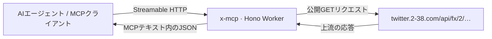

<div align="center">


# x-mcp

**X/Twitterの公開情報を、いつものAIエージェントから。**<br>投稿・プロフィール・トレンドを、読み取り専用のMCPで取得。<br>公開エンドポイントの利用に、Xへのログイン・APIキー・ローカルサーバーは不要です。

[](#はじめる) [](#利用範囲と制限) [](#はじめる) [](#仕組み) [](LICENSE)

**[はじめる](#はじめる)**&emsp;**[できること](#できること)**&emsp;**[ツール一覧](#ツール一覧)**&emsp;[開発](#開発)&emsp;[Read in English](README.md)

</div>

> [!NOTE]
> **検索・候補取得APIの制限（2026年11月27日確認）：** `search_posts` と `typeahead` は上流から `503` と「X/Twitter search is unavailable due to current API limitations.」を返しました。同じ確認で、MCPのツール一覧取得、`get_profile`、`get_trends`、`get_openapi` は成功しています。ツールが登録されていても、上流のデータを取得できるとは限りません。

## できること

- 🔎 **公開投稿を検索** — 上流の検索が利用可能なときに、キーワード・ハッシュタグ・`from:jack` などのX検索構文で検索。`latest` と `top` を選べます。
- 👤 **プロフィールや投稿を取得** — ハンドル名から公開プロフィール、数値IDから投稿、そのアカウントの最近の投稿やメディア付き投稿を取得します。
- 📈 **トレンドや候補を調べる** — 別のアプリを開かずにトレンドを取得でき、上流が対応しているときは入力候補も取得できます。
- 🔌 **リモートMCPに接続** — 公開済みのStreamable HTTPエンドポイントを利用できます。TypeScript + HonoのWorkerを自分で動かすこともできます。
- 🧭 **エージェントに使い方を渡す** — 同梱の[スキル](skills/x-mcp/SKILL.md)で、ツールの選び方、取得件数、ページ送り、出典リンクの付け方を伝えられます。

## はじめる

**リモートのStreamable HTTPに対応したAIエージェント、またはMCPクライアント**を用意してください。公開エンドポイントを使うだけなら、Cloudflareアカウントもリポジトリのcloneも不要です。

### 1. スキルを読み込んで接続する

スキルの読み込みとMCP設定ができるエージェントに、次を貼り付けてください。

```text
まず以下のx-mcpスキルをインストール、または読み込んでください。
https://raw.githubusercontent.com/kandotrun/x-mcp/main/skills/x-mcp/SKILL.md

その後、MCPサーバー名を `x`、接続方式をStreamable HTTPとして設定してください。
https://x.mcp.2-38.com/mcp

tools/listに、スキルに記載された8つのツールがあることを確認してください。
get_profileを { "handle": "jack" } で呼び、status: 200を確認してください。
続けてsearch_postsを { "q": "from:jack", "feed": "latest", "count": 2 } で試してください。
上流エラーが返った場合は、MCPの設定結果とは分けて報告してください。
このMCPは、公開X/Twitter情報の読み取り専用の取得に使ってください。
```

詳しい日英のプロンプトは[AIエージェント導入プロンプト](docs/agent-install-prompts.md)にあります。

<details>
<summary><b>クライアントに手動で設定する</b></summary>

`mcpServers` を使うクライアントでは、次の設定を基にしてください。

```json
{
  "mcpServers": {
    "x": {
      "url": "https://x.mcp.2-38.com/mcp"
    }
  }
}
```

クライアントによっては `servers` キーを使ったり、接続方式の明示が必要だったりします。URLはそのままで、**HTTP / Streamable HTTP**、認証なしを選んでください。

</details>

<details>
<summary><b>Hermes Agentで使う</b></summary>

```sh
hermes skills inspect https://raw.githubusercontent.com/kandotrun/x-mcp/main/skills/x-mcp/SKILL.md
hermes skills install https://raw.githubusercontent.com/kandotrun/x-mcp/main/skills/x-mcp/SKILL.md --category social-media -y
hermes mcp add x --url https://x.mcp.2-38.com/mcp
hermes mcp test x
```

または、`~/.hermes/config.yaml` に次を追加してください。

```yaml
mcp_servers:
  x:
    url: "https://x.mcp.2-38.com/mcp"
```

設定変更後はHermesを再起動するか、新しいセッションを開始してください。Hermesでは `mcp_x_search_posts` のように、ツール名に `mcp_x_` が付きます。

</details>

### 2. プロフィールを調べる

接続したエージェントに、次のように依頼します。

> `@jack` の公開Xプロフィールを調べて、プロフィールへのリンクを付けてください。

対応するツールは `get_profile` で、引数は次のとおりです。

```json
{ "handle": "jack" }
```

ツールの結果は、**JSONを文字列化したMCPのテキストコンテンツ**として返ります。プロフィール取得が成功すると、次のフィールドに加えて、上流の応答を含む `data` が返ります。

```json
{
  "upstreamUrl": "https://twitter.2-38.com/api/fx/2/profile/jack",
  "status": 200
}
```

検索を試す場合は、`search_posts` に `{ "q": "from:jack", "feed": "latest", "count": 2 }` を渡します。上流で失敗すると、MCPのツール結果に `isError: true` が付き、JSONテキストに `error` と、取得できた場合は `upstream` の詳細が入ります。投稿が0件だったと解釈せず、取得に失敗したことを報告してください。

## ツール一覧

目的に合うツールを選んでください。表の例は、**ツールに渡す引数**です。

| 調べたいこと | ツール | 引数の例 |
| --- | --- | --- |
| 公開投稿を検索 | `search_posts` | `{ "q": "from:jack", "feed": "latest", "count": 2 }` |
| IDが分かっている投稿を取得 | `get_post` | `{ "id": "2067319680654594543" }` |
| 公開プロフィールを取得 | `get_profile` | `{ "handle": "jack" }` |
| アカウントの最近の投稿を取得 | `get_profile_statuses` | `{ "handle": "jack", "count": 5 }` |
| アカウントのメディア付き投稿を取得 | `get_profile_media` | `{ "handle": "jack", "count": 5 }` |
| トレンドを取得 | `get_trends` | `{ "count": 5 }` |
| アカウントや検索語の候補を取得 | `typeahead` | `{ "q": "jack", "count": 5 }` |
| 上流APIのスキーマを確認 | `get_openapi` | `{}` |

`count` があるツールでは **1〜100件**を指定でき、既定は **10件**です。`search_posts` の `feed` は既定が `"latest"`、人気順は `"top"` です。検索・最近の投稿・メディア付き投稿のツールは、前の応答に含まれる `cursor` でページ送りできます。ハンドル名の先頭の `@` は省略できます。

## 仕組み



WorkerはMCP TypeScript SDKを使って、8つの読み取り専用ツールを公開します。既存の公開プロキシ `https://twitter.2-38.com/api/fx` を呼び出す仕組みで、利用者のXアカウントには接続しません。

| エンドポイント | 用途 |
| --- | --- |
| [`/mcp`](https://x.mcp.2-38.com/mcp) | クライアント接続用のStreamable HTTP MCPエンドポイント |
| [`/.well-known/mcp.json`](https://x.mcp.2-38.com/.well-known/mcp.json) | 接続先やツール名のメタデータ |
| [`/health`](https://x.mcp.2-38.com/health) | Workerの稼働確認と設定された上流URL。上流の稼働確認は行いません |

## 利用範囲と制限

- **公開情報の読み取り専用。** 投稿・いいね・リポスト・フォロー・DM・通知・非公開アカウント・認証済みタイムラインには対応しません。
- **クエリは外部に送信されます。** 公開Workerと `twitter.2-38.com` に送られるため、秘密情報・非公開データ・アクセストークンを引数に入れないでください。
- **データ取得は上流に依存します。** 可用性・レート制限・応答形式は `twitter.2-38.com` 次第です。MCPに接続できていても、上流エラーが返ることがあります。
- **導入方法はクライアントによって異なります。** 設定キーやスキルの導入方法は変わりますが、URLとStreamable HTTPという接続方式は共通です。

## 開発

Workerを開発する場合は、**Node.js 22以上**とnpmを用意してください。新しくcloneする場合の手順です。

```sh
git clone https://github.com/kandotrun/x-mcp.git
cd x-mcp
npm ci
cp wrangler.example.jsonc wrangler.jsonc
npm run check
npm run deploy:dry
npx wrangler dev --config wrangler.jsonc
```

ローカルMCPのURLは `http://localhost:8787/mcp` です。`npm run check` は `wrangler.example.jsonc` からWorkerのランタイム型を再生成し、TypeScriptの型チェックを行います。`npm run deploy:dry` はデプロイせずにWorkerをバンドルします。

| パス | 内容 |
| --- | --- |
| [`src/worker.ts`](src/worker.ts) | Honoのルート、MCPツール、上流リクエスト、エラー処理 |
| [`skills/x-mcp/SKILL.md`](skills/x-mcp/SKILL.md) | エージェント向けの導入・設定・利用ガイド |
| [`docs/agent-install-prompts.md`](docs/agent-install-prompts.md) | 日英のコピペ用プロンプト |
| [`wrangler.example.jsonc`](wrangler.example.jsonc) | アカウントIDをプレースホルダーにしたデプロイ設定の雛形 |

### 自分のWorkerをデプロイする

雛形をコピーした後、`wrangler.jsonc` のCloudflareアカウントIDと**自分のルート・ドメイン**を設定し、次を実行してください。

```sh
npm run deploy
```

`wrangler.jsonc` はgitignoreされています。アカウント固有の設定、`.dev.vars`、`.env*`、トークン、APIキーをGitに含めないでください。

### デプロイ後の確認

公開インスタンスの確認例です。自分でデプロイした場合はホスト名を置き換えてください。

```sh
curl -fsS https://x.mcp.2-38.com/health
curl -fsS https://x.mcp.2-38.com/.well-known/mcp.json
```

続けてMCPクライアントから `tools/list`、`get_profile` に `{ "handle": "jack" }`、`search_posts` に `{ "q": "from:jack", "feed": "latest", "count": 2 }` を渡して確認します。MCPのHTTP応答が成功でもツール結果はエラーの場合があるため、ツール結果まで確認してください。healthとメタデータが取得できるだけでは、実際のデータ取得が成功したとはいえません。

## ライセンス

[MIT](LICENSE)
