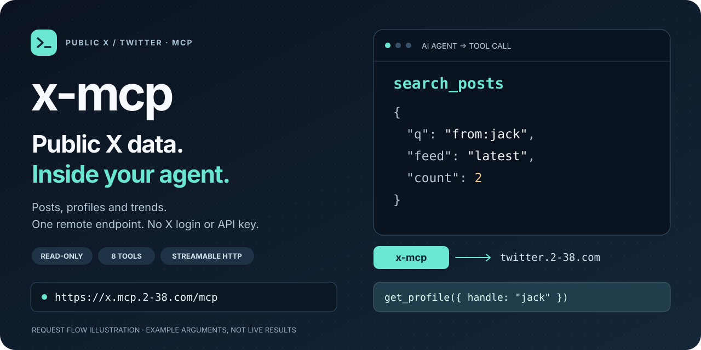
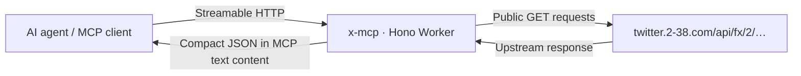

<div align="center">



# x-mcp

**Public X/Twitter data, inside your AI agent.**<br>Look up posts, profiles, timelines, followers and trends through one read-only MCP endpoint.<br>No X login, API key or local server needed to use the hosted endpoint.

[](https://github.com/kandotrun/x-mcp/actions/workflows/ci.yml) [](#quick-start) [](#scope-and-limits) [](#quick-start) [](#how-it-works) [](LICENSE)

**[Quick start](#quick-start)**&emsp;**[Features](#features)**&emsp;**[Tools](#tools)**&emsp;[Development](#development)&emsp;[日本語で読む](README.ja.md)

</div>

> [!NOTE]
> **Upstream keyword search is disabled (checked November 27, 2026).** `search_posts` and `typeahead` fail fast with `code: "feature_unavailable"` and a hint that names the alternative, such as `get_profile_statuses` for a `from:jack` query. Posts, profiles, timelines, followers, reposters and trends work.

## Features

- 👤 **Read posts and profiles** — Paste a post link (`x.com`, `twitter.com`, mobile) or ID, or a handle with or without `@` or as a profile URL. You get text, metrics, media, quotes, polls, Community Notes and the text of X Articles.
- 🧵 **Browse an account** — Recent posts and reposts (optionally with replies), media posts, X Articles, followers and the accounts it follows.
- 🔁 **See who reposted a post** — List the accounts that reposted it.
- 🪶 **Small, agent-friendly results** — Compact JSON summaries. `count` is enforced and `next_cursor` continues without gaps. A 2-post timeline is about 1,500 characters, down from about 125,000 in 0.1.
- 🧭 **Errors that say what to do next** — Every failure has a `code`, a `retryable` flag and a `hint`, e.g. which tool to use while search is down.
- 🔌 **Connect any remote MCP client** — Use the hosted Streamable HTTP endpoint, or run the TypeScript + Hono Worker yourself. The bundled [skill](skills/x-mcp/SKILL.md) teaches agents when to use each tool.

## Quick start

You need an AI agent or MCP client that supports **remote Streamable HTTP**. Using the hosted endpoint requires no Cloudflare account or repository clone.

### 1. Load the skill and connect

The bundled skill tells an agent when and how to use each tool. Paste this into an agent that can load skills and configure MCP servers:

```text
Install or load the x-mcp skill first:
https://raw.githubusercontent.com/kandotrun/x-mcp/main/skills/x-mcp/SKILL.md

Then configure an MCP server named `x` with Streamable HTTP:
https://x.mcp.2-38.com/mcp

Verify tools/list includes the tools documented in the skill.
Call get_post with { "id": "https://x.com/jack/status/20" } and check that post.text is "just setting up my twttr".
If a tool returns an upstream error such as feature_unavailable, report it separately from MCP setup.
Use this MCP for public, read-only X/Twitter lookups.
```

Longer prompts in both languages are in [Agent install prompts](docs/agent-install-prompts.md).

To add the server yourself, register it as `x`:

| Client | Command |
| --- | --- |
| Claude Code | `claude mcp add --transport http --scope user x https://x.mcp.2-38.com/mcp` |
| Codex (CLI, IDE extension, ChatGPT desktop) | `codex mcp add x --url https://x.mcp.2-38.com/mcp` |
| Gemini CLI | `gemini mcp add --scope user --transport http x https://x.mcp.2-38.com/mcp` |
| GitHub Copilot CLI | `copilot mcp add --transport http x https://x.mcp.2-38.com/mcp` |
| Devin Desktop (formerly Windsurf) | `devin mcp add -s user x https://x.mcp.2-38.com/mcp` |
| Cline | `cline mcp add x https://x.mcp.2-38.com/mcp --transport http --yes` |
| Hermes Agent | `hermes mcp add x --url https://x.mcp.2-38.com/mcp` (interactive: answer `n` to the authentication question, then enable all tools) |

For Claude Code, `--transport http` is required (the default is stdio). Other clients are configured as below. Tool names then appear as `mcp__x__get_post` (Claude Code), `mcp_x_get_post` (Hermes, Gemini CLI) and so on.

<details>
<summary><b>claude.ai and Claude Desktop</b></summary>

Customize → Connectors → Add → **Add custom connector**: name `x`, URL `https://x.mcp.2-38.com/mcp`, no authentication. Then enable `x` per conversation from the "+" menu → Connectors. On Team and Enterprise plans, an owner adds it under Organization settings → Connectors. The connector syncs to Desktop and mobile.

</details>

<details>
<summary><b>Cursor</b></summary>

Add to `~/.cursor/mcp.json` (or `.cursor/mcp.json` in a project), then restart Cursor:

```json
{
  "mcpServers": {
    "x": { "url": "https://x.mcp.2-38.com/mcp" }
  }
}
```

One-click install link: `cursor://anysphere.cursor-deeplink/mcp/install?name=x&config=eyJ1cmwiOiJodHRwczovL3gubWNwLjItMzguY29tL21jcCJ9`

</details>

<details>
<summary><b>VS Code (GitHub Copilot)</b></summary>

For the Copilot agent harness (the default since VS Code 1.143), add this to `~/.copilot/mcp-config.json` (shared with GitHub Copilot CLI) or to `.mcp.json` at the workspace root:

```json
{
  "mcpServers": {
    "x": { "type": "http", "url": "https://x.mcp.2-38.com/mcp", "tools": ["*"] }
  }
}
```

Older VS Code (Local harness) uses `.vscode/mcp.json` with a different top-level key: `{"servers": {"x": {"type": "http", "url": "https://x.mcp.2-38.com/mcp"}}}`.

</details>

<details>
<summary><b>Gemini CLI and Antigravity</b></summary>

`gemini mcp add --scope user --transport http x https://x.mcp.2-38.com/mcp` writes this to `~/.gemini/settings.json` (older releases need `"httpUrl"` instead of `"url"`):

```json
{
  "mcpServers": {
    "x": { "url": "https://x.mcp.2-38.com/mcp", "type": "http" }
  }
}
```

Antigravity (CLI and IDE) reads `~/.gemini/config/mcp_config.json` and uses `serverUrl`:

```json
{
  "mcpServers": {
    "x": { "serverUrl": "https://x.mcp.2-38.com/mcp" }
  }
}
```

</details>

<details>
<summary><b>Devin Desktop / Windsurf, Cline and Zed</b></summary>

- **Devin Desktop** (formerly Windsurf): `devin mcp add -s user x https://x.mcp.2-38.com/mcp`. The legacy Windsurf Cascade agent reads `~/.codeium/windsurf/mcp_config.json` with `{"mcpServers": {"x": {"serverUrl": "https://x.mcp.2-38.com/mcp"}}}`.
- **Cline**: `cline mcp add x https://x.mcp.2-38.com/mcp --transport http --yes`, or in the Cline panel: MCP Servers → Remote Servers, transport Streamable HTTP. When editing `cline_mcp_settings.json` by hand, set `"type": "streamableHttp"`; without it Cline falls back to legacy SSE, which this server does not offer.
- **Zed**: in `~/.config/zed/settings.json`, add `{"context_servers": {"x": {"url": "https://x.mcp.2-38.com/mcp"}}}`.

</details>

<details>
<summary><b>Hermes Agent</b></summary>

```sh
hermes skills inspect https://raw.githubusercontent.com/kandotrun/x-mcp/main/skills/x-mcp/SKILL.md
hermes skills install https://raw.githubusercontent.com/kandotrun/x-mcp/main/skills/x-mcp/SKILL.md --category social-media -y
hermes mcp add x --url https://x.mcp.2-38.com/mcp
hermes mcp test x
```

`hermes mcp add` is interactive: answer `n` when it asks whether the server needs authentication, then enable all tools. Agents and scripts should add this entry to `~/.hermes/config.yaml` instead:

```yaml
mcp_servers:
  x:
    url: "https://x.mcp.2-38.com/mcp"
```

Start a new session or run `/reload-mcp` after changing configuration. Hermes prefixes tool names with `mcp_x_`, for example `mcp_x_get_post`.

</details>

<details>
<summary><b>Other clients</b></summary>

For clients that use `mcpServers`, start with:

```json
{
  "mcpServers": {
    "x": {
      "url": "https://x.mcp.2-38.com/mcp"
    }
  }
}
```

Some clients use `servers` instead, or require an explicit transport/type field. Select **HTTP / Streamable HTTP**, with no authentication, and keep the same URL. The server is stateless: it answers `POST /mcp` and returns 405 for `GET` and `DELETE`, so there is no legacy SSE stream. A client that only runs local stdio servers can use a bridge:

```json
{
  "mcpServers": {
    "x": { "command": "npx", "args": ["-y", "mcp-remote", "https://x.mcp.2-38.com/mcp"] }
  }
}
```

</details>

### 2. Try a lookup

Ask your connected agent:

> Show me @jack's latest 2 posts with links.

The corresponding tool call is `get_profile_statuses` with:

```json
{ "handle": "jack", "count": 2 }
```

Tool results are **compact JSON in MCP text content**. A single post from `get_post` with `{ "id": "https://x.com/jack/status/20" }` looks like this:

```json
{"post":{"id":"20","url":"https://x.com/jack/status/20","created_at":"2006-03-21T20:50:14Z","author":{"handle":"jack","name":"jack","verified":true},"text":"just setting up my twttr","lang":"en","metrics":{"replies":19262,"reposts":126282,"quotes":8063,"likes":324575,"bookmarks":25521}}}
```

## Tools

Choose the narrowest tool for the question. These are **tool arguments**, not raw HTTP requests.

| You want to… | Tool | Example arguments |
| --- | --- | --- |
| Fetch a known post | `get_post` | `{ "id": "https://x.com/jack/status/20" }` |
| Look up a public profile | `get_profile` | `{ "handle": "@jack", "include_about": true }` |
| Read an account's recent posts | `get_profile_statuses` | `{ "handle": "jack", "count": 5 }` |
| Read an account's media posts | `get_profile_media` | `{ "handle": "nasa", "count": 5 }` |
| Read an account's X Articles | `get_profile_articles` | `{ "handle": "jack" }` |
| List an account's followers | `get_profile_followers` | `{ "handle": "jack", "count": 20 }` |
| List the accounts it follows | `get_profile_following` | `{ "handle": "jack", "count": 20 }` |
| List who reposted a post | `get_post_reposts` | `{ "id": "https://x.com/jack/status/20" }` |
| See trends | `get_trends` | `{ "count": 5 }` |
| Search public posts (**unavailable upstream now**) | `search_posts` | `{ "q": "from:jack", "feed": "latest", "count": 2 }` |
| Get account/query suggestions (**unavailable upstream now**) | `typeahead` | `{ "q": "jack", "count": 5 }` |
| Deprecated: static summary of upstream endpoints | `get_openapi` | `{}` |

- `id` accepts post URLs (`x.com`, `twitter.com`, mobile, `/photo/1` and `?s=20` suffixes) or numeric IDs as strings. `handle` accepts `jack`, `@jack` or `https://x.com/jack`.
- `count` accepts **1–100** and defaults to **10**; the server enforces it. `get_profile_statuses` takes `include_replies: true` for replies.
- `response_format: "detailed"` returns the full upstream objects (several times larger) instead of the concise fields.
- Replies to a post and whole threads cannot be listed.

### Results and errors

Single objects return `{post}` or `{user}`. Lists return:

```json
{"posts":[...],"returned":2,"has_more":true,"next_cursor":"xc1...."}
```

`users` replaces `posts` for account lists. While `has_more` is true, pass `next_cursor` back unchanged as `cursor` to continue. Cursors are bound to the tool and its arguments, and 0.1 raw upstream cursors still work. `note` explains short or empty results, and every result stays under 30,000 characters.

Errors are tool results with `isError: true`:

```json
{"error":"Keyword search is unavailable upstream right now (HTTP 503). This is not caused by your query, and retrying will not help.","code":"feature_unavailable","retryable":false,"hint":"This query asks for posts from @jack: call get_profile_statuses with {\"handle\":\"jack\",\"count\":10} and filter the results yourself.","upstream_status":503}
```

`code` is one of `invalid_argument`, `invalid_cursor`, `not_found`, `restricted`, `feature_unavailable`, `rate_limited`, `timeout`, `upstream_unavailable` or `internal`. Retry only when `retryable` is true. Report upstream errors as failures, not as empty results. See [CHANGELOG.md](CHANGELOG.md) for what changed from the 0.1 `{upstreamUrl, status, data}` output.

## How it works



The Worker exposes twelve read-only tools through the MCP TypeScript SDK. It calls the existing public proxy at `https://twitter.2-38.com/api/fx`, normalizes and trims the responses, and pages through them for you; it does not connect to your X account.

| Endpoint | Purpose |
| --- | --- |
| [`/mcp`](https://x.mcp.2-38.com/mcp) | Streamable HTTP MCP endpoint for clients (POST only) |
| [`/.well-known/mcp.json`](https://x.mcp.2-38.com/.well-known/mcp.json) | Discovery metadata and tool names |
| [`/health`](https://x.mcp.2-38.com/health) | Worker health, version and configured upstream base; does not test upstream availability |

## Scope and limits

- **Public and read-only.** No posting, liking, reposting, following, DMs, notifications, private accounts or authenticated timelines.
- **Queries leave your client.** They are sent to this public Worker and `twitter.2-38.com`. Keep secrets, private data and access tokens out of tool arguments.
- **Upstream-dependent data.** Availability, rate limits and response shape depend on `twitter.2-38.com`. A connected MCP server can still return upstream errors.
- **Bounded requests.** Request bodies are limited to 64 KiB and tool arguments to 32 elements. Each tool call makes at most 3 upstream requests, each with a 10-second timeout, and one HTTP request (including a JSON-RPC batch) at most 10.
- **Stateless pagination.** If posts are deleted or added between calls, some items may repeat (the result's `note` says so). A garbage 0.1-style raw cursor makes the upstream restart from the newest page.
- **Client-dependent setup.** Configuration keys and skill installation differ by client. The URL and Streamable HTTP transport remain the same.

## Development

For working on the Worker, you need **Node.js 24 or later**, **pnpm 12** ([installation](https://pnpm.io/installation); Node 25 and later no longer bundle Corepack) and, optionally, [just](https://github.com/casey/just). From a fresh clone:

```sh
git clone https://github.com/kandotrun/x-mcp.git
cd x-mcp
pnpm install
just check   # wrangler types + TypeScript for src and tests
just test    # vitest
just dev     # http://localhost:8787/mcp, using wrangler.example.jsonc
just smoke   # MCP smoke test against the local server (add --offline to skip upstream calls)
just build   # bundle the Worker without deploying
```

Every recipe has a `pnpm run` equivalent in `package.json`. CI runs check, test, build and an offline smoke test in workerd.

| Path | Contents |
| --- | --- |
| [`src/contract/`](src/contract) | Agent-facing contract: tool schemas and descriptions, output envelopes, messages, limits |
| [`src/domain/`](src/domain) | Pure logic: input normalization, cursors, pagination, projection, error classification |
| [`src/upstream/`](src/upstream) | The only I/O: upstream routes, HTTP client, per-call session |
| [`src/tools/handlers.ts`](src/tools/handlers.ts), [`src/server.ts`](src/server.ts), [`src/app.ts`](src/app.ts) | Tool handlers, MCP server wiring, Hono routes |
| [`test/`](test), [`scripts/smoke.ts`](scripts/smoke.ts) | Unit and MCP-level tests with synthetic fixtures; end-to-end smoke test |
| [`skills/x-mcp/SKILL.md`](skills/x-mcp/SKILL.md) | Agent installation, configuration and usage guide |
| [`docs/agent-install-prompts.md`](docs/agent-install-prompts.md) | English and Japanese copy/paste prompts |
| [`wrangler.example.jsonc`](wrangler.example.jsonc) | Deployment template with a placeholder account ID |

Worker vars:

| Var | Default | Meaning |
| --- | --- | --- |
| `UPSTREAM_BASE_URL` | `https://twitter.2-38.com/api/fx` | Upstream proxy base (https only) |
| `SEARCH_ENABLED` | `false` | Only changes tool wording; set `"true"` when upstream search works again |

### Deploy your own Worker

Copy the example config, set your Cloudflare account ID and **your own route/domain** in `wrangler.jsonc`, then deploy:

```sh
cp wrangler.example.jsonc wrangler.jsonc
# edit account_id and routes in wrangler.jsonc
just deploy
```

`wrangler.jsonc` is gitignored. Keep account-specific configuration, `.dev.vars`, `.env*`, tokens and API keys out of Git.

### Verify a deployment

For the hosted instance (pass your own URL for your deployment):

```sh
curl -fsS https://x.mcp.2-38.com/health
curl -fsS https://x.mcp.2-38.com/.well-known/mcp.json
just smoke-remote   # or: pnpm run smoke https://x.mcp.2-38.com/mcp
```

The smoke test connects as an MCP client, checks `tools/list`, reads `https://x.com/jack/status/20` with `get_post` (expecting `"just setting up my twttr"`) and pages through `get_profile_statuses`. It also warns when `SEARCH_ENABLED` no longer matches the live search state. A working health/discovery endpoint alone does not prove data retrieval.

## License

[MIT](LICENSE)
