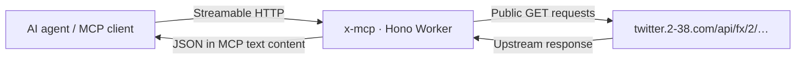

<div align="center">


# x-mcp

**Public X/Twitter data, inside your AI agent.**<br>Look up posts, profiles and trends through one read-only MCP endpoint.<br>No X login, API key or local server needed to use the hosted endpoint.

[](#quick-start) [](#scope-and-limits) [](#quick-start) [](#how-it-works) [](LICENSE)

**[Quick start](#quick-start)**&emsp;**[Features](#features)**&emsp;**[Tools](#tools)**&emsp;[Development](#development)&emsp;[日本語で読む](README.ja.md)

</div>

> [!NOTE]
> **Upstream search/suggestion limitation, checked November 27, 2026:** `search_posts` and `typeahead` returned `503` with “X/Twitter search is unavailable due to current API limitations.” MCP discovery, `get_profile`, `get_trends` and `get_openapi` succeeded in the same check. Tool registration does not guarantee upstream data availability.

## Features

- 🔎 **Find public posts** — Search by keyword, hashtag or X search syntax such as `from:jack`, with `latest` and `top` feeds when upstream search is available.
- 👤 **Look up a profile or post** — Fetch a public profile by handle, a post by numeric ID, or a profile's recent posts and media posts.
- 📈 **Explore trends and suggestions** — Request trends, or typeahead suggestions when available upstream, without opening a separate app.
- 🔌 **Connect a remote MCP client** — Use the hosted Streamable HTTP endpoint, or run the TypeScript + Hono Worker yourself.
- 🧭 **Give your agent a usage guide** — The bundled [skill](skills/x-mcp/SKILL.md) explains tool selection, small result counts, pagination and source links.

## Quick start

You need an AI agent or MCP client that supports **remote Streamable HTTP**. Using the hosted endpoint requires no Cloudflare account or repository clone.

### 1. Load the skill and connect

Paste this into an agent that can load skills and configure MCP servers:

```text
Install or load the x-mcp skill first:
https://raw.githubusercontent.com/kandotrun/x-mcp/main/skills/x-mcp/SKILL.md

Then configure an MCP server named `x` with Streamable HTTP:
https://x.mcp.2-38.com/mcp

Verify tools/list includes all eight tools documented in the skill.
Call get_profile with { "handle": "jack" } and check for status: 200.
Then try search_posts with { "q": "from:jack", "feed": "latest", "count": 2 }.
If a tool returns an upstream error, report it separately from MCP setup.
Use this MCP for public, read-only X/Twitter lookups.
```

Longer prompts in both languages are in [Agent install prompts](docs/agent-install-prompts.md).

<details>
<summary><b>Configure a client manually</b></summary>

For clients that use `mcpServers`, start with:

```json
{
  "mcpServers": {
    "x": {
      "url": "https://x.mcp.2-38.com/mcp"
    }
  }
}
```

Some clients use `servers` instead, or require an explicit transport/type field. Select **HTTP / Streamable HTTP**, with no authentication, and keep the same URL.

</details>

<details>
<summary><b>Use Hermes Agent</b></summary>

```sh
hermes skills inspect https://raw.githubusercontent.com/kandotrun/x-mcp/main/skills/x-mcp/SKILL.md
hermes skills install https://raw.githubusercontent.com/kandotrun/x-mcp/main/skills/x-mcp/SKILL.md --category social-media -y
hermes mcp add x --url https://x.mcp.2-38.com/mcp
hermes mcp test x
```

Or add this entry to `~/.hermes/config.yaml`:

```yaml
mcp_servers:
  x:
    url: "https://x.mcp.2-38.com/mcp"
```

Restart Hermes or start a new session after changing configuration. Hermes prefixes tool names with `mcp_x_`, for example `mcp_x_search_posts`.

</details>

### 2. Try a lookup

Ask your connected agent:

> Look up `@jack`'s public X profile and include a link to the profile.

The corresponding tool call is `get_profile` with:

```json
{ "handle": "jack" }
```

Tool results contain **JSON serialized as MCP text content**. A successful profile response includes the following fields, plus `data` containing the upstream response:

```json
{
  "upstreamUrl": "https://twitter.2-38.com/api/fx/2/profile/jack",
  "status": 200
}
```

For search, try `search_posts` with `{ "q": "from:jack", "feed": "latest", "count": 2 }`. An upstream failure returns an MCP tool result with `isError: true`; its JSON text includes `error` and may include `upstream` details. Report that failure instead of treating it as an empty set of posts.

## Tools

Choose the narrowest tool for the question. These are **tool arguments**, not raw HTTP requests.

| You want to… | Tool | Example arguments |
| --- | --- | --- |
| Search public posts | `search_posts` | `{ "q": "from:jack", "feed": "latest", "count": 2 }` |
| Fetch a known post | `get_post` | `{ "id": "2067319680654594543" }` |
| Look up a public profile | `get_profile` | `{ "handle": "jack" }` |
| Read a profile's recent posts | `get_profile_statuses` | `{ "handle": "jack", "count": 5 }` |
| Read a profile's media posts | `get_profile_media` | `{ "handle": "jack", "count": 5 }` |
| See trends | `get_trends` | `{ "count": 5 }` |
| Get account/query suggestions | `typeahead` | `{ "q": "jack", "count": 5 }` |
| Inspect the upstream API schema | `get_openapi` | `{}` |

Where supported, `count` accepts **1–100** and defaults to **10**. `search_posts` defaults to `feed: "latest"`; use `"top"` for the top feed. Search, profile-post and profile-media tools accept an optional `cursor` from a previous response. Handles may include or omit `@`.

## How it works



The Worker exposes eight read-only tools through the MCP TypeScript SDK. It calls the existing public proxy at `https://twitter.2-38.com/api/fx`; it does not connect to your X account.

| Endpoint | Purpose |
| --- | --- |
| [`/mcp`](https://x.mcp.2-38.com/mcp) | Streamable HTTP MCP endpoint for clients |
| [`/.well-known/mcp.json`](https://x.mcp.2-38.com/.well-known/mcp.json) | Discovery metadata and tool names |
| [`/health`](https://x.mcp.2-38.com/health) | Worker health and configured upstream base; does not test upstream availability |

## Scope and limits

- **Public and read-only.** No posting, liking, reposting, following, DMs, notifications, private accounts or authenticated timelines.
- **Queries leave your client.** They are sent to this public Worker and `twitter.2-38.com`. Keep secrets, private data and access tokens out of tool arguments.
- **Upstream-dependent data.** Availability, rate limits and response shape depend on `twitter.2-38.com`. A connected MCP server can still return upstream errors.
- **Client-dependent setup.** Configuration keys and skill installation differ by client. The URL and Streamable HTTP transport remain the same.

## Development

For working on the Worker, you need **Node.js 22 or later** and npm. From a fresh clone:

```sh
git clone https://github.com/kandotrun/x-mcp.git
cd x-mcp
npm ci
cp wrangler.example.jsonc wrangler.jsonc
npm run check
npm run deploy:dry
npx wrangler dev --config wrangler.jsonc
```

The local MCP endpoint is `http://localhost:8787/mcp`. `npm run check` regenerates local Worker runtime types from `wrangler.example.jsonc` and runs TypeScript checking. `npm run deploy:dry` bundles the Worker without deploying it.

| Path | Contents |
| --- | --- |
| [`src/worker.ts`](src/worker.ts) | Hono routes, MCP tools, upstream requests and error handling |
| [`skills/x-mcp/SKILL.md`](skills/x-mcp/SKILL.md) | Agent installation, configuration and usage guide |
| [`docs/agent-install-prompts.md`](docs/agent-install-prompts.md) | English and Japanese copy/paste prompts |
| [`wrangler.example.jsonc`](wrangler.example.jsonc) | Deployment template with a placeholder account ID |

### Deploy your own Worker

After copying the example config, set your Cloudflare account ID and **your own route/domain** in `wrangler.jsonc`, then run:

```sh
npm run deploy
```

`wrangler.jsonc` is gitignored. Keep account-specific configuration, `.dev.vars`, `.env*`, tokens and API keys out of Git.

### Verify a deployment

For the hosted instance (replace the host for your own deployment):

```sh
curl -fsS https://x.mcp.2-38.com/health
curl -fsS https://x.mcp.2-38.com/.well-known/mcp.json
```

Then use an MCP client to run `tools/list`, `get_profile` with `{ "handle": "jack" }`, and `search_posts` with `{ "q": "from:jack", "feed": "latest", "count": 2 }`. Check tool results as well as HTTP status: a tool error can arrive inside a successful MCP HTTP response. A working health/discovery endpoint alone does not prove data retrieval.

## License

[MIT](LICENSE)
